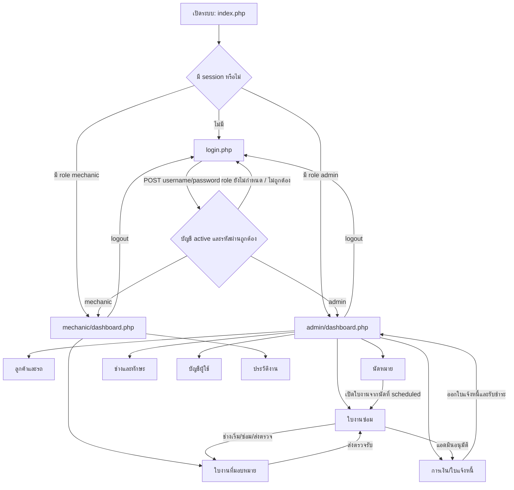

# Route Map ระบบบริหารอู่ซ่อมรถ

เอกสารนี้สรุปเส้นทางหน้าเว็บและการส่งข้อมูลของโปรเจกต์ตาม PHP ปัจจุบัน หน้าใน `admin/` ใช้สิทธิ์แอดมิน ส่วนหน้าใน `mechanic/` ใช้บัญชีช่างที่เข้าสู่ระบบแล้ว การบันทึกส่วนใหญ่ส่ง `POST` กลับมายังหน้าเดิม แล้ว redirect กลับด้วยรูปแบบ Post/Redirect/Get

## ภาพรวมเส้นทาง

## Entry, login และสิทธิ์

| Route | หน้าที่ / เส้นทางข้อมูล |
|---|---|
| `index.php` | ตรวจ session แล้วส่งไป dashboard ตาม role; ไม่มี session ส่งไปหน้า login |
| `login.php` | รับ `POST username`, `password`; ค้นบัญชี `users` ที่ `is_active = 1`, ตรวจ `password_verify`; role `admin` ไปหน้าแอดมิน, `mechanic` ไปหน้าช่าง, role ว่างแสดงว่ารอผู้ดูแลกำหนด |
| `logout.php` | ล้าง session และกลับ `login.php` |
| `includes/auth.php` | guard สำหรับผู้ใช้ที่ login แล้ว; ถ้าไม่มี session ให้กลับหน้า login |
| `includes/admin_auth.php` | ใช้ auth guard และตรวจ role `admin`; role อื่นกลับ `index.php` |
| `config/database.php` | สร้าง PDO connection ไป MySQL ฐาน `car_repair_system` |

## แอดมิน

| Route | ฟังก์ชัน / การกระทำ |
|---|---|
| `admin/dashboard.php` | ภาพรวมจำนวนลูกค้า รถ นัดหมาย ใบงาน ช่าง และยอดรับรายเดือน พร้อมรายการนัดหมาย/งานที่ใกล้ถึง |
| `admin/customers/index.php` | ค้นหาและจัดการลูกค้า (`add_customer`, `edit_customer`, `delete_customer`) และรถ (`add_vehicle`, `edit_vehicle`, `delete_vehicle`); แบบฟอร์มลูกค้าเลือกและค้นหาจังหวัด → อำเภอ/เขต → ตำบล/แขวง โดยจำกัดตัวเลือกตามระดับก่อนหน้า และกรอกรายละเอียดบ้านเลขที่/หมู่/ซอย/ถนน; มีแท็บลูกค้า/รถและค้นหา |
| `admin/appointments/index.php` | ค้นหานัดหมาย; เพิ่ม (`add_appointment`), แก้ (`edit_appointment`), ยกเลิก (`cancel_appointment`), บันทึกไม่มาตามนัด (`no_show`); โหลดรถตามลูกค้าที่เลือก; แสดงประวัติ workflow; ลิงก์ไปใบงานที่เกี่ยวข้อง |
| `admin/repair_jobs/index.php` | ค้นหา/กรองสถานะใบงาน; สร้างใบงาน (`create`) จากนัดหมายและเลือกช่าง; แก้ข้อมูล/เปลี่ยนช่าง (`update`); ตรวจรับ (`approve`) หรือส่งกลับให้ช่างแก้ (`return_work`); แสดงประวัติ workflow |
| `admin/technician/index.php` | จัดการข้อมูลช่าง (`add`, `edit`, `delete`), ความชำนาญ/ทักษะ และสถานะช่าง (`change_status`: พร้อมรับงาน/พักงาน); สถานะ busy คำนวณสัมพันธ์กับงานที่รับ |
| `admin/users/index.php` | จัดการบัญชี (`add`, `edit`, `reset_password`, `delete`); กำหนด role (`assign_role`) เป็น admin หรือ mechanic; เมื่อกำหนดเป็นช่างจะสร้าง/ผูกข้อมูลช่างและทักษะผ่าน `includes/user_roles.php`; กรองตาม role และบัญชีที่รอกำหนด role |
| `admin/financial/index.php` | ค้นหา/กรองใบแจ้งหนี้; สร้าง (`create_invoice`) จากใบงานที่ตรวจรับแล้ว, ระบุค่าแรง/อะไหล่/สถานะ; รับชำระ (`mark_paid`); ลบ (`delete_invoice`); คำนวณยอดรวมและสถานะค้างชำระ |
| `admin/customers/vehicles.php` | มีไฟล์ชื่อ route นี้ในโครงสร้าง แต่ไฟล์ว่าง; การจัดการรถที่ใช้งานจริงอยู่ในแท็บรถของ `admin/customers/index.php` |

## ช่าง

| Route | ฟังก์ชัน / การกระทำ |
|---|---|
| `mechanic/dashboard.php` | สรุปงานของช่างที่ login อยู่ แยกงานที่ต้องทำ/กำลังทำ/รอตรวจ/เสร็จ; จาก dashboard เริ่มงาน (`start`) หรือส่งตรวจ (`complete`) ได้ |
| `mechanic/repair_jobs/index.php` | ดูงานที่มอบหมายให้ช่างปัจจุบัน; เริ่มงาน (`start`), ปรับสถานะ/บันทึกหมายเหตุ (`update_status`), บันทึกรายการอะไหล่และราคา (`save_parts`), บันทึกผลตรวจ/ผลซ่อม/ปัญหาเพิ่มเติมและส่งให้แอดมินตรวจ (`complete`) |
| `mechanic/history/index.php` | ดูและค้นหาประวัติงานของช่าง พร้อมรายละเอียดและ timeline เหตุการณ์ |

## Workflow นัดหมาย → ซ่อม → การเงิน

### นัดหมาย (`includes/appointment_workflow.php`)

- `add_appointment`: ตรวจวันเวลา ประเภทบริการ และความสัมพันธ์รถกับลูกค้า แล้วบันทึกเป็น `scheduled` พร้อม event ประวัติ
- `edit_appointment`: แก้ได้เฉพาะนัดที่ยัง `scheduled`; ถ้าเลื่อนวัน/เวลา ต้องใส่เหตุผล
- `cancel_appointment`: ต้องระบุเหตุผล เปลี่ยนสถานะเป็น `cancelled`
- `no_show`: ต้องระบุเหตุผลและถึงเวลานัดแล้ว จึงเปลี่ยนเป็น `no_show`
- ทุก action ทำใน transaction และบันทึก `workflow_events`

### ใบงาน (`includes/repair_workflow.php`)

- สร้างใบงานได้จากนัด `scheduled` ที่ยังไม่มีใบงาน และเลือกช่างที่พร้อมรับงาน; สร้างใบงานสถานะ `waiting` และทำให้นัดเป็น `attended`
- ช่างเจ้าของงานเท่านั้นที่ทำ action ฝั่งช่างได้: `waiting` → `in_progress` ด้วย `start`; `in_progress` → `awaiting_review` ด้วย `complete` พร้อมบันทึกรายละเอียดซ่อม
- แอดมิน `approve` งานที่รอตรวจเพื่อปิดขั้นซ่อม; `return_work` ส่งกลับช่างพร้อมเหตุผล; `update` แก้รายละเอียด/มอบหมายช่างใหม่ตามเงื่อนไขใน workflow
- การเปลี่ยนสถานะสำคัญและการแก้ไขถูกตรวจซ้ำฝั่งเซิร์ฟเวอร์ภายใน transaction พร้อมบันทึก event; การมอบหมาย/ปล่อยงานปรับสถานะช่างตามงานที่ค้าง
- สถานะใบงานที่หน้าแอดมินแสดงรวมถึง `waiting`, `in_progress`, `awaiting_review`, `completed`, `waiting_payment`, `paid`, `closed`, `cancelled`; การเปลี่ยนขั้นขึ้นกับ action และ invoice workflow

### ใบแจ้งหนี้

- แอดมินสร้าง invoice จากใบงานที่ผ่านการตรวจรับ โดยยอดรวมมาจากค่าแรงและอะไหล่
- การรับชำระเปลี่ยน invoice เป็น paid และปรับสถานะที่เกี่ยวข้องตามกฎใน `admin/financial/index.php`
- มีหน้าประวัติ workflow เชื่อมการกระทำกับผู้ใช้และนัดหมาย/ใบงาน

## ไฟล์ส่วนกลางและฐานข้อมูล

| ไฟล์ | ใช้โดย |
|---|---|
| `includes/appointment_workflow.php` | เพิ่ม/แก้/ยกเลิก/ไม่มาตามนัด และประวัตินัดหมาย |
| `includes/repair_workflow.php` | สร้างใบงาน, ตรวจสิทธิ์และสถานะก่อนเปลี่ยนงาน, sync สถานะช่าง, ประวัติ workflow |
| `includes/user_roles.php` | กำหนด role ให้บัญชี และสร้าง/ผูกข้อมูลช่างกับทักษะใน transaction |
| `assets/data/thailand-address.json` | รายชื่อจังหวัด อำเภอ/เขต และตำบล/แขวงสำหรับ dropdown ที่อยู่ลูกค้า |
| `includes/confirmation_modal.php`, `assets/js/confirmation-modal.js` | กล่องยืนยันก่อน action สำคัญ |
| `includes/logout_modal.php` | กล่องยืนยันก่อนออกจากระบบ |
| `database/migrations/20260929_appointment_repair_workflow.sql` | เปลี่ยน schema รองรับ workflow นัดหมาย/ใบงาน |
| `database/migrations/20260929_pending_user_roles.sql` | รองรับบัญชีที่ยังไม่ได้กำหนด role |

## หมายเหตุขอบเขต

จาก route ที่มีในโปรเจกต์นี้เป็นระบบหลังบ้านสำหรับแอดมินและช่าง ยังไม่พบหน้า portal สำหรับลูกค้า, REST API หรือ route แยกสำหรับรายงาน/ส่งออกข้อมูล; แต่ละหน้า PHP ทำหน้าที่ทั้งแสดงผลและรับ POST action ในไฟล์เดียวกัน
